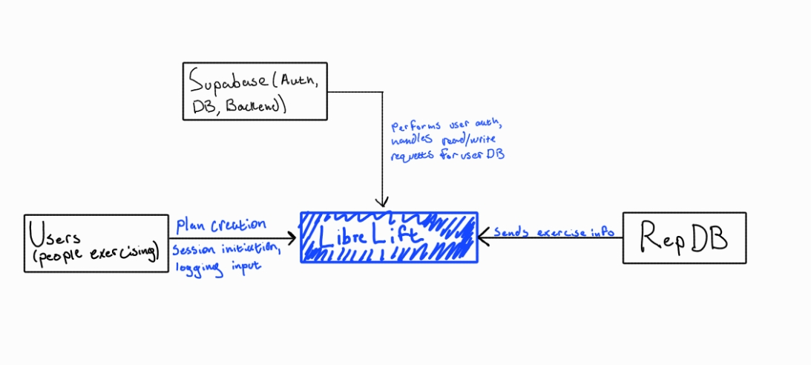
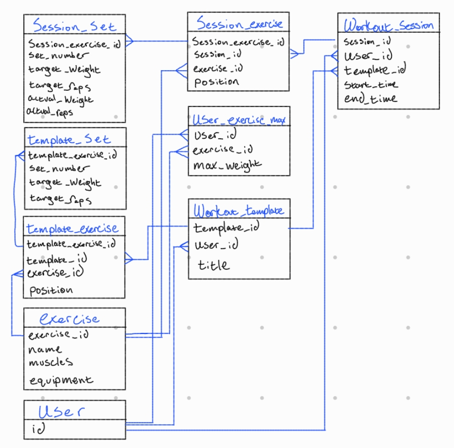

# LibreLift - Design Document

|                  |                                                                                                                                                           |
| ---------------- | --------------------------------------------------------------------------------------------------------------------------------------------------------- |
| **Authors**      | James Teuscher                                                                                                                                            |
| **Reviewers**    | [who reviewed it — a teammate, the instructor, a design-review partner]                                                                                   |
| **Status**       | In review                                                                                                                                                 |
| **Last updated** | 11-9-26                                                                                                                                                   |
| **Links**        | [proposal](../cp3/cp3-proposal) · [repository](https://github.com/LibreLift/expo_suite) · [issue tracker](https://github.com/LibreLift/expo_suite/issues) |

## Revision history

| Date     | Author         | What changed                   |
| -------- | -------------- | ------------------------------ |
| 10-16-26 | James Teuscher | First draft                    |
| 10-20-26 | James Teuscher | First full draft               |
| 10-21-26 | James Teuscher | Finished first copy            |
| 11-4-26  | James Teuscher | Revised to respond to feedback |
| 11-9-26  | Codex | Record frontend decisions and clarify shared terminology |

---

## 1. Context and scope

LibreLift is a native mobile app for planning, logging, and tracking workouts for those who want to use their phones to do so. It aims to provide the basic functions of creating reusable workout templates, using a template for a workout and logging reps and weight, and reviewing the details of past workouts. For more information about the context of this project, see the [proposal document](../cp3/cp3-proposal).

Use the [glossary](../GLOSSARY.md) for canonical domain terms. The
[architecture decision records](./adr/README.md) and
[UI foundation decision summary](./ui-foundation.md) explain the frontend choices
recorded during #38.

## 2. Goals and non-goals

**Goals**

- Connect to RepDB, an external exercise DB, and load the catalog of ~500 free exercises into the app for use. Besides name, the exercises in the app should be identifiable by target muscles and equipment.
- Support creation, persistence, editing, and deletion of reusable workout templates.
- Support starting, stopping, and completing workout sessions for an existing template. Workout sessions allow recording repetitions performed and weight used for each session exercise.
- Support storing "one-rep" maximum weight for certain exercises, and enter weight in template exercises as a percentage of that maximum.

**Non-goals**

- Social exercising features such as followers/friends, sharing workouts, leaving comments, etc., are excluded. They fall outside the scope of primary user needs.
- No body composition and fitness goal customization. 

## 3. System-context diagram

There will only be one type of user interacting with this system. They will create workout templates and record workout sessions. The CDN/API that provides a catalog of exercises will interact with the system by providing the exercise catalog via HTTP. Lastly, Supabase will interact with the system by providing the authentication service, database and data access layer, and serverless backend to handle HTTP requests for auth and data access.

## 4. Architecture and components

| Component      | Responsibility                                                                   | Talks to                            | Interface (rough)                     |
| -------------- | -------------------------------------------------------------------------------- | ----------------------------------- | ------------------------------------- |
| View           | Displays UI and accepts user input                                               | ViewModel                           | function calls, touch screen elements |
| ViewModel      | Business logic of logging, templating, and weight calculation                    | View, Service                       | function calls                        |
| Service        | Makes calls to backend to read/write data for ViewModel operations               | ViewModel, HTTPHandlers             | function calls, HTTP                  |
| HTTPHandlers   | Accepts incoming HTTP calls from frontend, handles request payloads              | Service, DataAccess, Authentication | function calls, HTTP                  |
| Authentication | Accepts authentication requests via HTTP, uses Supabase auth to accept or reject | HTTPHandler                         | function calls, HTTP                  |
| DataAccess     | Adjusts HTTP payloads to be ready for DB reads/writes                            | DB, HTTPHandlers                    | function calls, HTTP                  |
| DB             | Stores data persistently, supplies data for app UI                               | DataAccess                          | HTTP                                  |

### Initial frontend foundation (#38)

The Expo/TypeScript frontend follows MVVM: View components render hooks in the
ViewModel layer, which depend on an injected asynchronous `WorkoutService`.
The root layout supplies a sample implementation until backend integration is
available. Template targets and historical session values are separate snapshots.

Expo Router provides three bottom tabs: Templates (initial), Workouts, and Account.
Templates have detail screens with inline title/description editing and
session-local Save/Cancel. Workout history has independently collapsible exercise
sections. Account links to a sign-in placeholder and Settings. These screens use
sample records; authentication, full template CRUD, backend persistence, and
workout logging remain feature integrations.

The root owns a sample service instance for the app session. Successful metadata
updates invalidate the template ViewModels so both list and detail reload saved
values. A shared pending-save state locks tab navigation; the editor also guards
Back/swipe and preserves drafts on failures. See the
[UI iteration decisions](./ui-foundation.md#approved-ui-iteration) for exact behavior.

Settings offers Light, Dark, and System appearance, defaulting to System. The
preference is stored locally through an injected storage interface. Both themes
use the [selected palette](https://colorhunt.co/palette/2c36393f4e4fa27b5cdcd7c9)
with additional neutral colors for readability. Sample weights use pounds.

The app uses SDK 58 to match the Expo Go version installed on the review device.
See [setup](./setup.md) for compatibility and device review instructions.

### Exercise catalog boundary (#44)

RepDB JSON is validated at the service boundary into a shared catalog exercise
model with a namespaced catalog identifier, English name, separate primary and
secondary muscles, and explicit equipment requirements. Optional images,
instructions, and German/Spanish content are retained for future features.
Usable records are returned with diagnostics for malformed data; an unusable
response has a distinct failure result. Live transport and catalog browsing are
separate tasks.

Template exercises and session exercises each have their own placement identity
and copy descriptive exercise details and sets, retaining the shared catalog
identity. Upstream catalog changes cannot alter saved templates or history.
See the [catalog contract and tracking](./issue-44-exercise-catalog.md) and
[identity decision](./adr/issue-44-catalog-identity-and-snapshots.md).

### Core flow - Making a workout template

1. A user logs in or signs up with credentials
2. User taps the screen to create a workout template
3. View layer sends input to ViewModel
4. ViewModel navigates to template creator business logic, calls service to load catalog
5. Service calls the Exercise CDN to load catalog, returns data to ViewModel
6. ViewModel sends exercises to View
7. View displays exercises
8. User chooses exercises, weight, reps
9. View sends selections to ViewModel
10. ViewModel saves the workout template in-memory as the user builds it
11. User taps "Save plan"
12. View call ViewModel's save function
13. ViewModel sends workout template data to service via function call
14. Service serializes the workout template into JSON, calls backend via HTTP
15. HTTPHandler receives workout template JSON, passes to DataAccess layer via function call
16. DataAccess layer deserializes JSON, writes to DB via HTTP

### The failure case

1. User taps the screen to create a workout template
2. View layer sends input to ViewModel
3. ViewModel navigates to template creator business logic, calls service to load catalog
4. Service checks if the catalog is cached. If not, call the Service layer
5. Service calls the Exercise CDN to load catalog, returns data to ViewModel
6. CDN throws an error and does not return catalog
7. Service passes an error to the ViewModel layer
8. ViewModel layer formats the error message to display on the UI
9. UI displays the error message for the User, asks to wait for a period and then try again

### Core flow - Logging a workout:

1. A user logs in using credentials
2. User selects one of their templates and taps  a "Start workout" button.
3. A stopwatch/counter displays workout duration, and lists the exercises in the workout.
4. For each exercise, the user is able to tap it and see a detailed view 
5. The user can adjust actual weight and reps used if it differs from the templated amounts
6. After performing a set of one exercise, the user marks that set complete.
7. This is repeated for the planned sets of each exercise; the MVP does not group exercises into circuit rounds.
8. When finished, the user taps "Finish workout"
9. The workout session is completed and added to the user's workout history
10. The user can navigate to workout history and see the details of their session

### The failure case

1. A user logs in using credentials
2. User selects one of their templates and taps  a "Start workout" button.
3. The user proceeds through the workout as stated above
4. When tapping the "Finish workout" button, the DB write fails
5. The error message is sent back to the user and told to try again in a few minutes.
6. If the error persists a second time, the user is presented a button to send feedback.
7. The feedback link sends an email to the maintainers with the user input.

## 5. Data model

| Entity            | Key fields                                                                             | Relationships                                                             | MVP or roadmap |
| ----------------- | -------------------------------------------------------------------------------------- | ------------------------------------------------------------------------- | -------------- |
| User              | id                                                                                     | has workout templates, has workout sessions, and has exercise max weights | MVP            |
| Exercise          | exercise_id, name, muscles, equipmenet                                                 | has a User max weight, part of template exercise and session exercise     | MVP            |
| Workout template  | userId, template_id, title                                                             | belongs to User, has exercises, fills a workout session                   | MVP            |
| Template exercise | template_exercise_id, exercise_id, template_id, position                               | part of Workout template, is an exercise, has sets                        | MVP            |
| Template set      | template_exercise_id, set_number, target_weight, target_reps                           | part of Template exercise                                                 | MVP            |
| User exercise max | user_id, exercise_id, max_weight                                                       | belongs to User, describes exercise                                       | MVP            |
| Workout session   | session_id, user_id, template_id, start_time, end_time                                 | belongs to user, filled by workout template, contains session exercises   | MVP            |
| Session exercise  | session_exercise_id, session_id, exercise_id, position                                 | part of Workout session, has session sets                                 | MVP            |
| Session sets      | sesson_exercise_id, set_number, target_weight, target_reps, actual_weight, actual_reps | part of session workout                                                   | MVP            |

**ERD:**

## 6. Technology choices and alternatives considered

### Decision: What ExerciseDB/CDN will be used

- **Chosen:** RepDB
- **Alternative considered:** yuhonas/free-exercise-db
- **Why the chosen option wins, given our goals:** There is a free starter license, and the example images are superior than those in free-exercise-db
- **Evidence:** The spike utilized RepDB, while a personal side project has utilized free-exercise-db, and the RepDB images are superior, while muscle grouping, exercises available, and instructions are roughly equivalent.
- **What would change our mind:** If the user base grows enough that the RepDB free license is no longer usable, I would want to switch to the free alternative of free-exercise-db
### Decision: Which Backend as a Service (BaaS) technology will be used?

- **Chosen**: Supabase
- **Alternative considered**: Firebase
- **Why the chosen option wins, given our goals**: 2 main reasons: First, Supabase is better build for open-source contributions, since contributors can run a local version of the backend without needing access to the production credentials. Second, the data model for LibreLift (workouts, exercises, template vs session) fits well in a relational model, which is more readily available in Supabase. One advantage that Firebase does have is out of the box support for offline-synchronization.
- **Evidence**: The Supabase CLI allows any developer to run backend services locally with one command (`npx supabase start`). This is a huge asset for an open-source project. Supabase is naturally relational with PostgreSQL, and Firebase is natively NoSQL. Firebase does support SQL using SQL Connect, which requires some additional configuration. Offline synchronization is possible with Supabase, but requires more manual configuration than Firebase.
- **What would change our mind**: If offline synchronization became too complex with Supabase, switching to Firebase would become a real consideration. Or, if the scale of the project grows enough and pricing between Supabase and Firebase favor Firebase, that would also merit considering a switch.

### Decision: What authentication method will be used

**Chosen**: Offer both Email + password and Email OTP
**Alternatives considered**: Email magic link, Google OAuth, Apple OAuth.
**Why the chosen option wins, given our goals**: They provide some flexibility for users to make a password or not, without introducing the overhead required for OAuth providers.
**Evidence**: Email + password and Email OTP options are provided by default with Supabase auth, and the docs even contain code for implementing them in React Native. Google and Apple OAuth require things like making a Google Cloud project, setting up OAuth scopes, getting clientIDs, or with Apple, rotating keys every 6 months.
**What would change our mind**: Strong user demand for Google/Apple OAuth options. They will likely be added to the roadmap anyway, just after M2.

## 7. Risks and open questions

| Risk or question                                                                                                          | Why it matters                                                                                                                                                                                                  | Owner | How we'll find out, and by when                                                                       |
| ------------------------------------------------------------------------------------------------------------------------- | --------------------------------------------------------------------------------------------------------------------------------------------------------------------------------------------------------------- | ----- | ----------------------------------------------------------------------------------------------------- |
| How precisely to represent workout and exercise templates vs workout and exercise sessions/completions in the data model? | Doing so inefficiently can erode DB performance, and add unnecessary overhead to the Data Access component                                                                                                      | James | Do research during M1, determine the ideal data model                                                 |
| How to provision Supabase Edge functions and DB                                                                           | This is where all of the data storage and backend computing will live. Without this, the app does not provide value.                                                                                            | James | Read Supabase docs and run through quick starts for DB and Edge functions during  M1                  |
| How to distribute to iOS devices without the $99/year developer profile fee?                                              | Purchasing the developer profile would significantly increase the cost of the project. But, iOS is a major mobile OS that cannot be simply neglected, but must be supported                                     | James | Research distribution methods during M1 and M2, select a long-term solution with a fallback plan.     |
| RepDB's Starter license has limited terms                                                                                 | Misunderstanding the limits could lead to legal liability, necessity to purchase their expensive paid license, or pivot to another exercise catalog                                                             | James | Determine and document limits of free version of license during M2, before public demo and release    |
| Will workouts be lost if the final save fails?                                                                            | Some gyms have spotty wifi, so the final save to the DB failing is a very real possibility. Users losing their logged progress due to this would be a major failure in one of the primary intentions of the app | James | During M2, research methods to backup copies of the workout session and recover if the DB write fails |

## 8. Implementation plan

| Milestone | What works when it's done                                                                                                                     | Depends on | Build hours (estimate) |
| --------- | --------------------------------------------------------------------------------------------------------------------------------------------- | ---------- | ---------------------- |
| 1         | The first core flow (template creation) works, without "one-rep" maximum support. Editing and deleting templates is also supported.           | —          | 12                     |
| 2         | Both core flows (template creation and workout sessions) work and  support "one-rep" maximum recording and calculations based off that value. | 1          | 8                      |

---

## Sign-off

| Reviewer | Role   | Date   | Approved |
| -------- | ------ | ------ | -------- |
| [name]   | [role] | [date] | ☐        |
