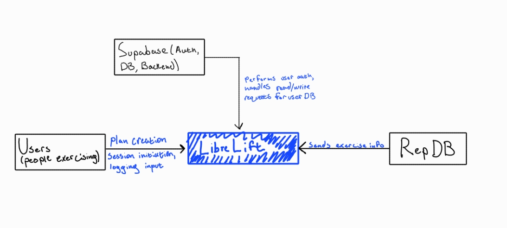
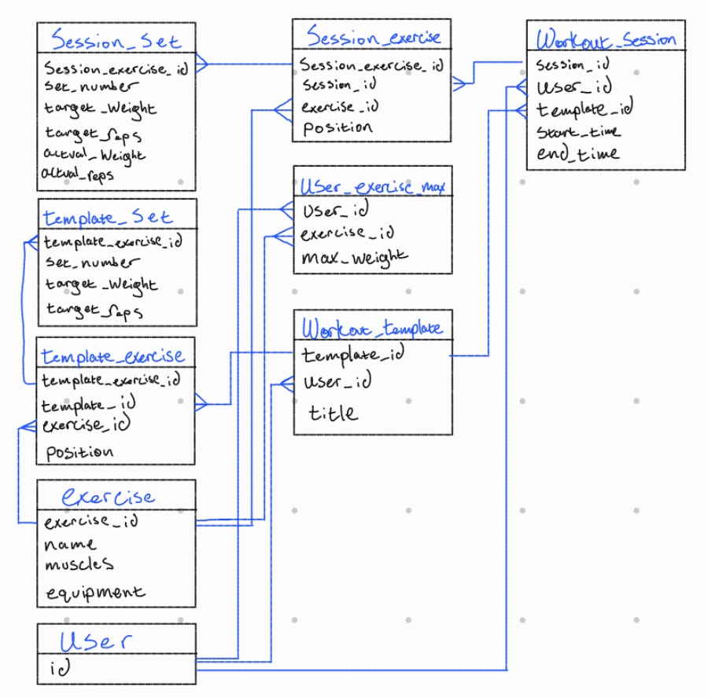

# OpenFit - Design Document

|                  |                                                                                                                                                           |
| ---------------- | --------------------------------------------------------------------------------------------------------------------------------------------------------- |
| **Authors**      | James Teuscher                                                                                                                                            |
| **Reviewers**    | [who reviewed it — a teammate, the instructor, a design-review partner]                                                                                   |
| **Status**       | In review                                                                                                                                                 |
| **Last updated** | 11-17-26                                                                                                                                                  |
| **Links**        | [proposal](../cp3/cp3-proposal) · [repository](https://github.com/open-source-fitness/open-fit) · [issue tracker](https://github.com/open-source-fitness/open-fit/issues) |

## Revision history

| Date     | Author         | What changed                   |
| -------- | -------------- | ------------------------------ |
| 10-16-26 | James Teuscher | First draft                    |
| 10-20-26 | James Teuscher | First full draft               |
| 10-21-26 | James Teuscher | Finished first copy            |
| 11-4-26  | James Teuscher | Revised to respond to feedback |
| 11-9-26  | Codex | Record frontend decisions and clarify shared terminology |
| 11-17-26 | Codex | Record the confirmed M1 database scope and account-name ownership |

---

## 1. Context and scope

OpenFit is a native mobile app for planning, logging, and tracking workouts for those who want to use their phones to do so. It aims to provide the basic functions of creating reusable workout templates, using a template for a workout and logging reps and weight, and reviewing the details of past workouts. For more information about the context of this project, see the [proposal document](../cp3/cp3-proposal).

Use the [glossary](../GLOSSARY.md) for canonical domain terms. The
[architecture decision records](./adr/README.md) and
[UI foundation decision summary](./ui-foundation.md) explain the frontend choices
recorded during #38.

## 2. Goals and non-goals

**Goals**

- Connect to RepDB, an external exercise DB, and load its free exercise catalog into the app for use. Besides name, the exercises in the app should be identifiable by target muscles and equipment.
- Support creation, persistence, editing, and deletion of reusable workout templates.
- Support starting, stopping, and completing workout sessions for an existing template. Workout sessions allow recording repetitions performed and weight used for each session exercise.
- Support storing "one-rep" maximum weight for certain exercises, and enter weight in template exercises as a percentage of that maximum.

**Non-goals**

- Social exercising features such as followers/friends, sharing workouts, leaving comments, etc., are excluded. They fall outside the scope of primary user needs.
- No body composition and fitness goal customization. 

## 3. System-context diagram

There will only be one type of user interacting with this system. They will create workout templates and record workout sessions. The CDN/API that provides a catalog of exercises will interact with the system by providing the exercise catalog via HTTP. Lastly, Supabase will interact with the system by providing the authentication service, database and data access layer, and serverless backend to handle HTTP requests for auth and data access.

## 4. Architecture and components

| Component      | Responsibility                                                                   | Talks to                            | Interface (rough)                     |
| -------------- | -------------------------------------------------------------------------------- | ----------------------------------- | ------------------------------------- |
| View           | Displays UI and accepts user input                                               | ViewModel                           | function calls, touch screen elements |
| ViewModel      | Business logic of logging, templating, and weight calculation                    | View, Service                       | function calls                        |
| Service        | Makes calls to backend to read/write data for ViewModel operations               | ViewModel, HTTPHandlers             | function calls, HTTP                  |
| HTTPHandlers   | Accepts incoming HTTP calls from frontend, handles request payloads              | Service, DataAccess, Authentication | function calls, HTTP                  |
| Authentication | Accepts authentication requests via HTTP, uses Supabase auth to accept or reject | HTTPHandler                         | function calls, HTTP                  |
| DataAccess     | Adjusts HTTP payloads to be ready for DB reads/writes                            | DB, HTTPHandlers                    | function calls, HTTP                  |
| DB             | Stores data persistently, supplies data for app UI                               | DataAccess                          | HTTP                                  |

### Initial frontend foundation (#38)

The Expo/TypeScript frontend follows MVVM: View components render hooks in the
ViewModel layer, which depend on an injected asynchronous `WorkoutService`.
The root layout originally supplied a sample implementation; the #45 persistence
integration below now supplies production template operations. Template targets and historical session values are separate snapshots.

Expo Router provides three bottom tabs: Templates (initial), Workouts, and Account.
Templates have a saved overview listing exercise names and set counts. Each
placement opens saved exercise detail with its preserved image (or an unavailable
placeholder) and compact read-only set rows. Saved detail reads the template
snapshot without loading the catalog. The complete draft editor manages name,
optional description, catalog exercise placements, and independent fixed-weight
sets.
Editing uses a template overview for name/description, exercise count, membership,
and order, plus a separate screen for one placement’s sets and targets. Each set
is one row: Set number, reps input, ×, weight input, and pounds. Back/Done from
exercise editing returns to the overview without committing; both screens share
one draft, and Save/Cancel on the overview applies to all changes. The overview's
Sets button sits beside the exercise title and trash control. Saved targets and
editable targets use the same row layout; only the editor exposes numeric inputs
and set removal.
Creation, whole-template updates, and deletion use the injected asynchronous
WorkoutService backed by memory. New templates append to the list. Successful
mutations invalidate list/detail reads and refresh counts. A fresh app session
restored the two samples. The #45 integration below supersedes that production
composition; controlled in-memory services remain test doubles.

The root owns the service and shared draft state, allowing catalog selection to
return to the same draft. Repeated catalog exercises have independent placement
identities and snapshots. The builder supports long-press dragging from an
edit-only three-line handle, scrolling while dragging, and accessible Move up/down
alternatives. All targets move with their placement. Existing history remains
independent of template edits/deletions.

Save validates and commits the whole draft atomically. Failed saves preserve it
for retry. Tabs preserve unfinished drafts; Back/swipe offers discard/keep editing.
Save/Cancel applies to the entire draft. Pending saves/deletes lock conflicting
actions and navigation. Delete requires confirmation naming the template and
returns to the list on success. See the [confirmed #91 specification](./issue-91-template-crud.md)
for target validation, lifecycle, and testing decisions.

Workout history has independently collapsible exercise sections. Account displays
the application User's name and Auth account's email, offers name editing, and
links to Settings. Email-code account access gates training; workout logging
remains a feature integration.

Settings offers Light, Dark, and System appearance, defaulting to System. The
preference is stored locally through an injected storage interface. Both themes
use the [selected palette](https://colorhunt.co/palette/2c36393f4e4fa27b5cdcd7c9)
with additional neutral colors for readability. Sample weights use pounds.

The app uses SDK 58 to match the Expo Go version installed on the review device.
See [setup](./setup.md) for compatibility and device review instructions.

### Authentication session lifecycle (#43)

Stored Supabase authentication is restored before protected navigation mounts,
then the application User is loaded using the existing name/onboarding contract.
No application lifetime or inactivity timeout is imposed. The SDK owns persisted
credentials and refresh; protected operations use its current identity.

Routine same-account token refresh preserves drafts and navigation. Unusable
access gates training; retryable failures preserve stored credentials and offer
Retry, Sign out, and appearance Settings. Recovery starts a clean account load
and discards unsaved work/navigation with an explanation. Definitively ended
authentication returns to email access. Native foreground/background handling
starts/stops SDK auto-refresh and checks expired access on return.

Device-local sign-out confirms unsaved changes, is disabled during saves, and
succeeds locally despite server revocation failure. Local storage cleanup failure
instead gates access behind Retry sign-out. Forced loss overrides pending guards.
An account-generation boundary resets account-specific services, providers,
drafts, cached reads, edits, and navigation, while late results cannot restore
old state. Appearance preferences and saved backend records remain. Future
maximums state must share this lifecycle; its concrete verification remains #49.
See [the confirmed #43 specification](issue-43-auth-sessions.md).

### Exercise catalog boundary (#44)

RepDB JSON is validated at the service boundary into a shared catalog exercise
model with a namespaced catalog identifier, English name, separate primary and
secondary muscles, and explicit equipment requirements. Optional images,
instructions, and German/Spanish content are retained in the model.
Usable records are returned with diagnostics for malformed data; an unusable
response has a distinct failure result.

The #83 implementation adds a temporary standalone catalog screen opened from
Templates. A separately injected catalog service receives an HTTP request
function and loads the single JSON document at
`https://exercise-dataset.com/exercises.json`, using the existing mapper. The
ViewModel exposes loading, usable results, and defined transport/response failure
states. A virtualized list shows exercises alphabetically with colloquial muscle
groups and equipment. Primary and secondary groups remain separate; raw muscles
remain unchanged in the model. Rejected records produce a quiet partial-results
notice; optional-content diagnostics alone do not. Each visit loads afresh,
retaining results while open, with Back available on failure. Caching, retries,
and adding or saving exercises in the template editor remain separate work.
The #84 implementation combines case-insensitive exercise-name search with one
primary muscle-group filter, defaulting to All muscles. Secondary targets never
cause filter matches. No-match results offer Clear search and filter without
another request. Search/filter state survives tab changes while the route stays
open and resets on leaving and reopening. The catalog and README credit RepDB.
See [the agreed catalog behavior](./issue-53-exercise-catalog.md).

Tapping a catalog card opens an image-first detail screen using the selected
record from that visit. Start/peak images are swipeable, labeled pages with
Previous/Next controls; single illustrations use the same uncropped image area.
Images have independent loading/failure states. Group summaries, equipment, and
numbered English instructions follow the images. The mounted list retains its
scroll position and controls beneath detail without another JSON request.
The selected record is released when the catalog list unmounts. A detail route
without it offers Open catalog. See [the confirmed detail behavior](./catalog-exercise-detail.md).

Template exercises and session exercises each have their own placement identity
and copy descriptive exercise details and sets, retaining the shared catalog
identity. Upstream catalog changes cannot alter saved templates or history.
See the [catalog contract and tracking](./issue-44-exercise-catalog.md) and
[identity decision](./adr/issue-44-catalog-identity-and-snapshots.md).

### Core flow - Making a workout template

1. A user logs in or signs up with credentials
2. User taps the screen to create a workout template
3. View layer sends input to ViewModel
4. ViewModel navigates to template creator business logic, calls service to load catalog
5. Service calls the Exercise CDN to load catalog, returns data to ViewModel
6. ViewModel sends exercises to View
7. View displays exercises
8. User chooses exercises, weight, reps
9. View sends selections to ViewModel
10. ViewModel saves the workout template in-memory as the user builds it
11. User taps "Save plan"
12. View call ViewModel's save function
13. ViewModel sends workout template data to service via function call
14. Service serializes the workout template into JSON, calls backend via HTTP
15. HTTPHandler receives workout template JSON, passes to DataAccess layer via function call
16. DataAccess layer deserializes JSON, writes to DB via HTTP

### The failure case

1. User taps the screen to create a workout template
2. View layer sends input to ViewModel
3. ViewModel navigates to template creator business logic, calls service to load catalog
4. Service checks if the catalog is cached. If not, call the Service layer
5. Service calls the Exercise CDN to load catalog, returns data to ViewModel
6. CDN throws an error and does not return catalog
7. Service passes an error to the ViewModel layer
8. ViewModel layer formats the error message to display on the UI
9. UI displays the error message for the User, asks to wait for a period and then try again

### Core flow - Logging a workout:

1. A user logs in using credentials
2. User selects one of their templates and taps  a "Start workout" button.
3. A stopwatch/counter displays workout duration, and lists the exercises in the workout.
4. For each exercise, the user is able to tap it and see a detailed view 
5. The user can adjust actual weight and reps used if it differs from the templated amounts
6. After performing a set of one exercise, the user marks that set complete.
7. This is repeated for the planned sets of each exercise; the MVP does not group exercises into circuit rounds.
8. When finished, the user taps "Finish workout"
9. The workout session is completed and added to the user's workout history
10. The user can navigate to workout history and see the details of their session

### The failure case

1. A user logs in using credentials
2. User selects one of their templates and taps  a "Start workout" button.
3. The user proceeds through the workout as stated above
4. When tapping the "Finish workout" button, the DB write fails
5. The error message is sent back to the user and told to try again in a few minutes.
6. If the error persists a second time, the user is presented a button to send feedback.
7. The feedback link sends an email to the maintainers with the user input.

## 5. Data model

| Entity            | Key fields                                                                             | Relationships                                                             | MVP or roadmap |
| ----------------- | -------------------------------------------------------------------------------------- | ------------------------------------------------------------------------- | -------------- |
| User              | id, account_name                                                                       | has workout templates, has workout sessions, and has exercise max weights | MVP            |
| Exercise          | exercise_id, name, muscles, equipmenet                                                 | has a User max weight, part of template exercise and session exercise     | MVP            |
| Workout template  | userId, template_id, title                                                             | belongs to User, has exercises, fills a workout session                   | MVP            |
| Template exercise | template_exercise_id, exercise_id, template_id, position                               | part of Workout template, is an exercise, has sets                        | MVP            |
| Template set      | template_exercise_id, set_number, target_weight, target_reps                           | part of Template exercise                                                 | MVP            |
| User exercise max | user_id, exercise_id, max_weight                                                       | belongs to User, describes exercise                                       | MVP            |
| Workout session   | session_id, user_id, template_id, start_time, end_time                                 | belongs to user, filled by workout template, contains session exercises   | MVP            |
| Session exercise  | session_exercise_id, session_id, exercise_id, position                                 | part of Workout session, has session sets                                 | MVP            |
| Session sets      | sesson_exercise_id, set_number, target_weight, target_reps, actual_weight, actual_reps | part of session workout                                                   | MVP            |

### M1 database scope and account data (#102)

See the [confirmed #102 specification](./issue-102-database.md) for acceptance
criteria, implementation boundaries, and the approved database testing seam.

The M1 database includes an application-owned User table, workout templates,
template exercises, and template sets. Workout sessions, session exercises,
session sets, personal exercise maximums, and percentage-based targets are added
through later migrations for M2; the table above describes the broader MVP model.

The application-owned User table stores the editable account name and uses the
Supabase Auth account's ID as its identity. Training records reference this
application User for ownership and relationships. The account name is a display
name, not a unique sign-in identifier. This decision replaces #42's use of Auth
user metadata for the account name. Do not add application columns to or otherwise
alter Supabase's managed Auth schema; Supabase Auth continues to manage credentials
and authentication sessions.

After email verification, an authenticated account-data read loads the application
User if one exists. An absent User requires name onboarding without creating a
row. Submitting a valid account name creates the User with the Auth account's ID;
a failed save preserves the entered name for retry. Existing Users load their
stored account name. Account access integration in #42 must follow this flow.

If email-code verification succeeds but the application User lookup fails, retain
the verified authentication session in memory and keep training screens gated.
Show an actionable error with **Retry loading account**, which retries only the
User lookup, without requesting or verifying another code. Appearance Settings
remains available. Only a successful lookup with no User opens name onboarding;
a lookup failure remains in the retry state. This recovery is part of #42;
authentication restoration and lifecycle are specified below.

Template exercises store their placement identity, namespaced catalog identity,
parent template, and position relationally. Each placement also stores a complete
descriptive JSON snapshot, including name, distinct primary and secondary muscles,
equipment, and available images, instructions, and translations. Template sets
remain relational. Saved detail reads these snapshots without consulting the live
catalog; #102 does not import a shared exercise catalog table. This implements the
existing catalog identity and snapshot decision rather than treating the ERD's
Exercise entity as a live source of saved descriptions.

Authenticated database requests use the requesting account's context so row-level
security applies. Explicit grants and policies allow only owner-scoped access to
application User and template data; anonymous access is denied. Backend operations
must not routinely bypass these policies with a privileged service credential.
Deleting a template cascades to its placements and sets. Deleting an Auth account
cascades to its application User and owned templates. Users cannot change their
identity or transfer ownership. An account-deletion UI remains outside M1 scope.

Saved templates and template-exercise placements use UUID identities. Placement
identity remains unchanged when exercises move; a separate numeric position
records order. Template sets use numbers within their placement. Templates store
creation timestamps for stable list ordering. Draft identity conversion belongs
to #45's persistence integration.

Database constraints enforce valid relationships, nonblank names, nonnegative
finite decimal weights in pounds, positive integer target repetitions, and unique
exercise positions and set numbers within their parents. Issue #45 validates and
saves a complete template atomically, including at least one exercise, at least
one set per exercise, and consecutive ordering. Multirow edits may temporarily
have incomplete structure within their transaction.

Issue #102's primary verification seam is the real local Supabase database, using
anonymous and two authenticated identities. Tests verify allowed operations,
ownership isolation and attempted ownership changes, invalid values, snapshots,
ordering, and deletion cascades. Migrations must rebuild cleanly and apply to a
populated database without losing existing records. App-flow verification remains
with #42 and #45. Deliver locally verified migrations and hosted deployment
instructions; applying them to the shared hosted backend follows the existing
post-review maintainer workflow. Do not automatically seed user data or sample
templates.

Issue #102 owns the M1 schema, relationship constraints, access grants, row-level
security, and database verification. Issue #45 builds template persistence
operations and app integration on that foundation; #43 owns authentication-session
restoration. Valid stored authentication is restored automatically, while explicit
sign-out or an app reinstall requires another email OTP. Saved templates belong
to the account and survive app reloads, restarts, updates, and reinstalls when
using the same backend. Unsaved template drafts remain temporary.

### Template persistence (#45)

The [confirmed #45 specification](./issue-45-template-persistence.md) governs the
implemented production template service; hosted deployment and device audit remain
separate review activities. Whole-template
saves use an authenticated Edge Function/data-access boundary and an invoker-rights
transactional database function; see [ADR 0005](./adr/0005-save-template-aggregates-transactionally.md).
An unchanged save retry recovers its original committed result without duplicate
creation or overwriting later saves. Distinct concurrent saves use last-committed
whole-template replacement; updates never recreate deleted templates, and deletion
of an absent template succeeds. Production accounts receive no sample templates;
workout history remains visibly labeled sample data until #47. The approved tests
combine existing router-level behavior checks with the real production service
through HTTP to disposable local Supabase. The root shares one lazy authenticated
client and injects Expo Crypto UUID generation into its account-scoped service.
Every production request checks its account and pins that session's bearer token;
a switched account cannot reuse an older service. A guarded refresh retries a
rejected current token once. Definitive loss enters existing account recovery,
scoped by account identity and generation so late failures cannot clear a new
account. Ordinary permission/transport errors preserve the draft. See the
[validation record](./issue-125-template-production.md) and setup commands.

**ERD:**

## 6. Technology choices and alternatives considered

### Decision: What ExerciseDB/CDN will be used

- **Chosen:** RepDB
- **Alternative considered:** yuhonas/free-exercise-db
- **Why the chosen option wins, given our goals:** There is a free starter license, and the example images are superior than those in free-exercise-db
- **Evidence:** The spike utilized RepDB, while a personal side project has utilized free-exercise-db, and the RepDB images are superior, while muscle grouping, exercises available, and instructions are roughly equivalent.
- **What would change our mind:** If the user base grows enough that the RepDB free license is no longer usable, I would want to switch to the free alternative of free-exercise-db
### Decision: Which Backend as a Service (BaaS) technology will be used?

- **Chosen**: Supabase
- **Alternative considered**: Firebase
- **Why the chosen option wins, given our goals**: 2 main reasons: First, Supabase is better build for open-source contributions, since contributors can run a local version of the backend without needing access to the production credentials. Second, the data model for OpenFit (workouts, exercises, template vs session) fits well in a relational model, which is more readily available in Supabase. One advantage that Firebase does have is out of the box support for offline-synchronization.
- **Evidence**: The Supabase CLI allows any developer to run backend services locally with one command (`npx supabase start`). This is a huge asset for an open-source project. Supabase is naturally relational with PostgreSQL, and Firebase is natively NoSQL. Firebase does support SQL using SQL Connect, which requires some additional configuration. Offline synchronization is possible with Supabase, but requires more manual configuration than Firebase.
- **What would change our mind**: If offline synchronization became too complex with Supabase, switching to Firebase would become a real consideration. Or, if the scale of the project grows enough and pricing between Supabase and Firebase favor Firebase, that would also merit considering a switch.

### Decision: What authentication method will be used

**Chosen**: Email OTP only.
**Alternatives considered**: Email + password, email magic link, Google OAuth, Apple OAuth.
**Why the chosen option wins, given our goals**: Users are expected to sign in infrequently and remain signed in on their device. Email OTP avoids managing a rarely used password and the configuration overhead of OAuth providers.
**Evidence**: Supabase supports email OTP for new and returning users and renewable sessions without a default maximum lifetime. During the Issue #42 design discussion, this approach was selected based on the expected infrequency of sign-ins for a gym app. The expectation is that users will sign in once and then use the app as desired.
**What would change our mind**: Evidence that users need another sign-in method.

See [ADR 0004: Use email OTP for account access](./adr/0004-email-otp-account-access.md)
for the agreed account-access behavior, session boundary, and testing decisions.

## 7. Risks and open questions

| Risk or question                                                                                                          | Why it matters                                                                                                                                                                                                  | Owner | How we'll find out, and by when                                                                       |
| ------------------------------------------------------------------------------------------------------------------------- | --------------------------------------------------------------------------------------------------------------------------------------------------------------------------------------------------------------- | ----- | ----------------------------------------------------------------------------------------------------- |
| How precisely to represent workout and exercise templates vs workout and exercise sessions/completions in the data model? | Doing so inefficiently can erode DB performance, and add unnecessary overhead to the Data Access component                                                                                                      | James | Do research during M1, determine the ideal data model                                                 |
| How to provision Supabase Edge functions and DB                                                                           | This is where all of the data storage and backend computing will live. Without this, the app does not provide value.                                                                                            | James | Read Supabase docs and run through quick starts for DB and Edge functions during  M1                  |
| How to distribute to iOS devices without the $99/year developer profile fee?                                              | Purchasing the developer profile would significantly increase the cost of the project. But, iOS is a major mobile OS that cannot be simply neglected, but must be supported                                     | James | Research distribution methods during M1 and M2, select a long-term solution with a fallback plan.     |
| RepDB's Starter license has limited terms                                                                                 | Misunderstanding the limits could lead to legal liability, necessity to purchase their expensive paid license, or pivot to another exercise catalog                                                             | James | Determine and document limits of free version of license during M2, before public demo and release    |
| Will workouts be lost if the final save fails?                                                                            | Some gyms have spotty wifi, so the final save to the DB failing is a very real possibility. Users losing their logged progress due to this would be a major failure in one of the primary intentions of the app | James | During M2, research methods to backup copies of the workout session and recover if the DB write fails |

## 8. Implementation plan

| Milestone | What works when it's done                                                                                                                     | Depends on | Build hours (estimate) |
| --------- | --------------------------------------------------------------------------------------------------------------------------------------------- | ---------- | ---------------------- |
| 1         | The first core flow (template creation) works, without "one-rep" maximum support. Editing and deleting templates is also supported.           | —          | 12                     |
| 2         | Both core flows (template creation and workout sessions) work and  support "one-rep" maximum recording and calculations based off that value. | 1          | 8                      |

---

## Sign-off

| Reviewer | Role   | Date   | Approved |
| -------- | ------ | ------ | -------- |
| [name]   | [role] | [date] | ☐        |
